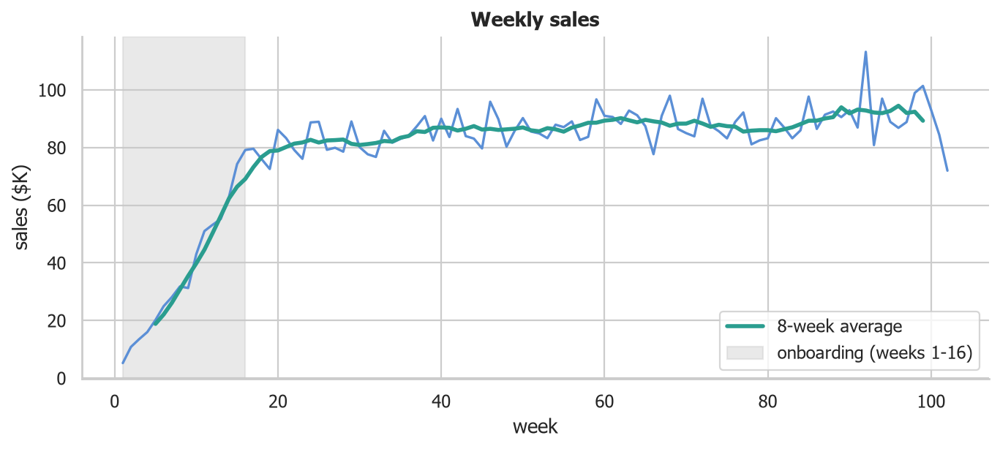
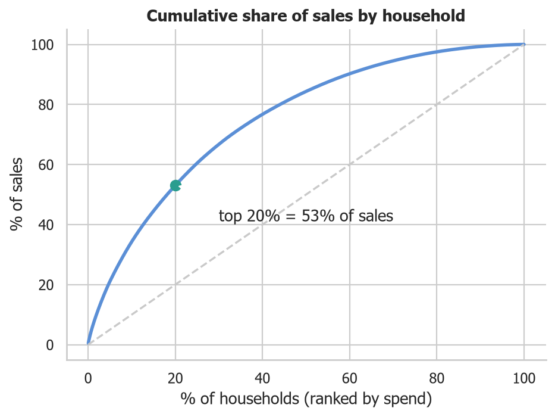
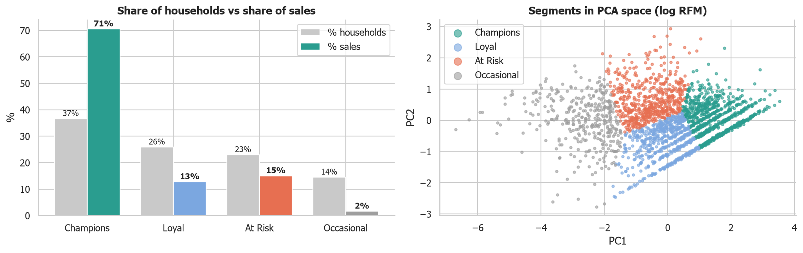
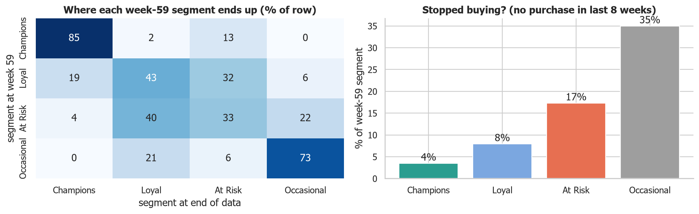
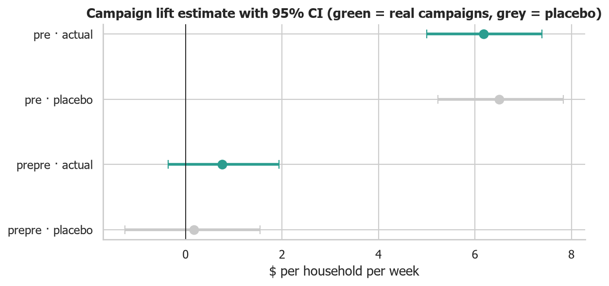
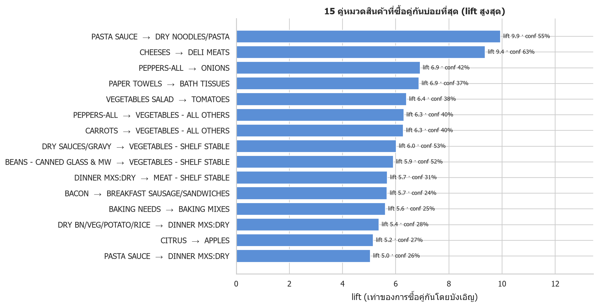
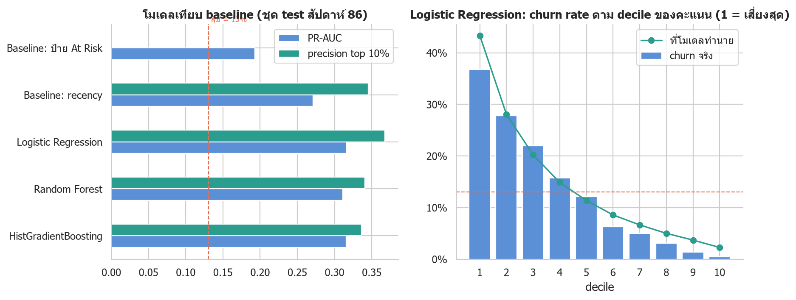
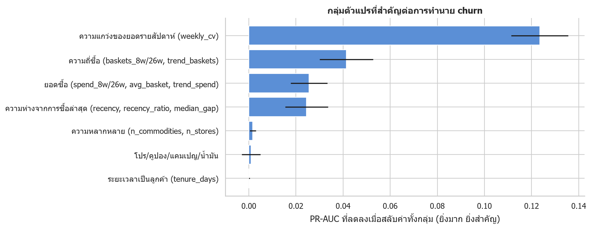
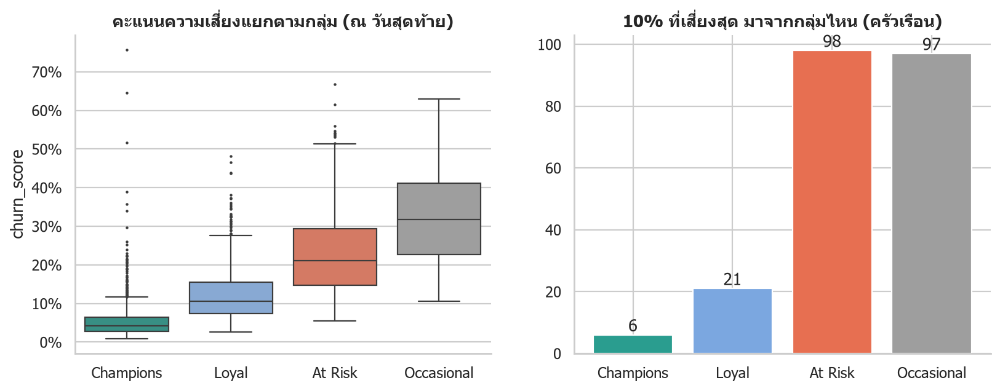
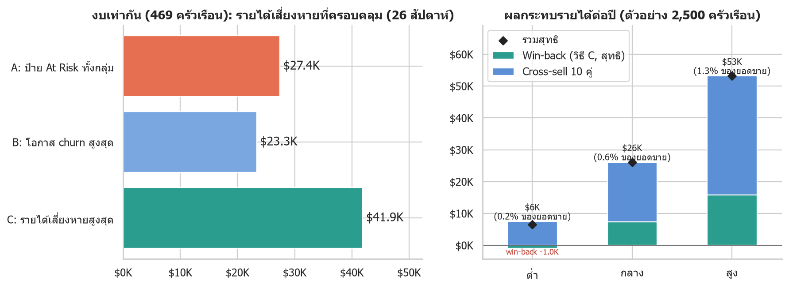

# Tesco Customer Segmentation & Promotion Strategy — รายงานฉบับสมบูรณ์

DSI313 · ข้อมูล dunnhumby *The Complete Journey* (2,500 ครัวเรือน · 102 สัปดาห์ · ยอดขาย $8.06M)
โค้ดและผลทุกตัวเลขอยู่ใน `notebooks/01–07` · กราฟอยู่ใน `reports/figures/`

---

## บทสรุปผู้บริหาร

Tesco ในสหรัฐฯ ใช้ส่วนลดหน้าร้านแบบหว่าน (~$696K/ปี หรือ 15% ของราคาเต็ม) และส่งแคมเปญไปที่ลูกค้าที่ดีอยู่แล้ว (74% ไป Champions)
แต่ **ยังพิสูจน์ไม่ได้ว่าแคมเปญเพิ่มยอดซื้อ** (lift +$0.76/ครัวเรือน/สัปดาห์, 95% CI −0.4 ถึง +1.9)

| ตัวเลขสำคัญ | ค่า |
|---|---|
| Champions 37% ของครัวเรือน ทำยอดขาย | **71%** |
| Champions ที่หลุดไปเป็น At Risk ใน ~10 เดือน | **13%** |
| ลูกค้าที่จะลดยอด > 70% ใน 8 สัปดาห์ข้างหน้า | **13%** (~275 ครัวเรือน) |
| โมเดล churn เลือกคนแม่นกว่าป้าย At Risk (งบเท่ากัน, ทดสอบ 2 สัปดาห์) | **30% vs 18–25%** |
| เลือกคนตามโอกาส churn × ยอดซื้อ ครอบคลุมยอดที่หายไปจริงของคน churn | **50–64% vs 26–27%** (ป้าย At Risk) |
| คู่สินค้าที่ซื้อด้วยกันเสถียรข้ามปี | **100%** ของคู่ที่หาได้จากปีแรก (981 คู่) |

**ข้อเสนอ 3 ข้อ**
1. **Win-back ตามมูลค่า** — ใช้คะแนน churn × ยอดใช้จ่าย เลือกคนส่งข้อเสนอดึงกลับ แทนการส่งให้ทั้งกลุ่ม At Risk
2. **โปร "ชุดมื้อ"** ใน GROCERY + MEAT ช่วง 15–19 น. จากคู่สินค้าที่ลูกค้าซื้อด้วยกันอยู่แล้ว
3. **ย้ายส่วนลดหว่าน 5–10% ไปเป็นข้อเสนอเฉพาะกลุ่ม และใส่ holdout ในทุกแคมเปญ**

**ผลกระทบที่คาดได้:** +$6K ถึง +$53K ต่อปี (0.2–1.3% ของยอดขาย) ในตัวอย่างนี้ ด้วยงบ win-back ~$9K/ปี = ~1% ของส่วนลดหน้าร้านที่จ่ายอยู่ · **win-back คุ้มเมื่อดึงลูกค้ากลับได้ ≥ ~11% ของคนที่จะ churn (เลือกตามมูลค่า) ซึ่งยังไม่มีหลักฐานว่าทำได้ จึงต้องทดสอบ holdout ก่อนขยาย**

---

## 1. ผลวิเคราะห์ฉบับสมบูรณ์

### 1.1 ข้อมูลและการเตรียมข้อมูล (notebook 01)
- ตัด 18,917 แถว (0.7%) ที่ `QUANTITY = 0` หรือ `SALES_VALUE <= 0` — ยอดขายรวมไม่เปลี่ยน
- ตาราง `coupon` มี 5,164 แถวซ้ำ (นับแบบ unique) · key ระหว่างตารางครบ
- 90% ของครัวเรือนเริ่มซื้อภายในสัปดาห์ 16 → การเทียบตามเวลาเริ่มที่สัปดาห์ 17
- ข้อมูลประชากรมี 801 ครัวเรือน (32%) และเอนเอียงไปทาง Champions
- ไม่ได้ทำ **Satisfaction/NPS** เพราะข้อมูลไม่มีแบบสอบถาม → ใช้ RFM/CLV ตามทางเลือกของโจทย์

### 1.2 EDA (notebook 02)
| KPI | ค่า |
|---|---|
| ยอดขาย 2 ปี / ต่อปี | $8.06M / $4.11M |
| ยอดเฉลี่ยต่อสัปดาห์ (สัปดาห์ 17–102) | $87K · ครึ่งหลังสูงกว่าครึ่งแรก 5.8% |
| ครัวเรือน top 20% | 53% ของยอดขาย |
| GROCERY / Private label | 51% / 28% ของยอดขาย |
| มูลค่าตะกร้า เฉลี่ย / มัธยฐาน | $29.24 / $17.18 |
| ตะกร้าช่วง 15:00–19:59 | 44% |
| ยอดที่ขายตอนลดราคา (ไม่นับน้ำมัน) | 47% |

### 1.3 Segmentation: RFM + K-Means (notebook 03)
RFM แปลง log1p + standardize · K-Means k = 4 (silhouette 0.33 · ARI ข้าม seed 0.96)

| กลุ่ม | ครัวเรือน | % ยอดขาย | Recency (วัน) | ครั้ง/สัปดาห์ | CLV 12 เดือน (มัธยฐาน) |
|---|---|---|---|---|---|
| **Champions** — ประจำ/มูลค่าสูง | 916 (37%) | 71% | 3 | 1.8 | $3,050 |
| **Loyal** — ซื้อซ้ำ | 647 (26%) | 13% | 4 | 0.6 | $908 |
| **At Risk** — เริ่มห่างหาย | 575 (23%) | 15% | 23 | 0.6 | $740 |
| **Occasional** — ครั้งคราว | 362 (14%) | 2% | 56 | 0.2 | $110 |

**ทดสอบกับข้อมูลที่ไม่เคยเห็น** (แบ่งกลุ่มด้วยข้อมูลถึงสัปดาห์ 59 → ดูสัปดาห์ 60–102):
- Champions เสถียรที่สุด: 85% ยังเป็น Champions และ 13% ตกไป At Risk
- At Risk หยุดซื้อใน 8 สัปดาห์สุดท้าย 17% (Loyal 8%, Champions 4%) แต่ **~83% กลับมาซื้อเอง** → ป้ายกลุ่มอย่างเดียวไม่แม่นพอ
- โครงสร้างหมวดของแต่ละกลุ่มนิ่ง (เปลี่ยน ±1 pp) · GROCERY 53–56% ทุกกลุ่ม

**CLV** (ยอดเฉลี่ย 26 สัปดาห์ล่าสุด × 52, เชิงรายได้): Champions ทำรายได้คาดการณ์ ~72%

### 1.4 Campaign & Pricing (notebook 04)
- แคมเปญ 30 ครั้ง เข้าถึง 1,584 ครัวเรือน · **74% ของการส่งไป Champions** · 73% ของผู้ได้รับไม่เคยใช้คูปอง
- อัตราใช้คูปอง Type A 16% vs Type B/C ~8%
- **Campaign lift** (difference-in-differences + placebo test + bootstrap CI):

| วิธีจับกลุ่มเทียบ | ช่วงจริง | ช่วง placebo | ผล |
|---|---|---|---|
| ยอดช่วงก่อนแคมเปญ (`pre`) | +$6.18 | +$6.51 | ใช้ไม่ได้ — placebo ให้ผลเท่ากัน (regression to the mean) |
| ยอดช่วงก่อนหน้านั้น (`prepre`) | **+$0.76** (CI −0.4 ถึง +1.9) | +$0.18 | ผ่าน placebo · ไม่ต่างจากศูนย์ |

- ส่วนลดหน้าร้าน ~$696K/ปี (15% ของราคาเต็ม) เทียบคูปอง ~$16K/ปี · ทุกกลุ่มได้ส่วนลดในสัดส่วนใกล้กัน

### 1.5 Market Basket Analysis (notebook 05)
FP-Growth (ผลเหมือน Apriori) ระดับ COMMODITY · 254K ตะกร้า (ไม่นับน้ำมัน) · min support 1%

- **980 คู่** ที่ lift ≥ 1.5, support ≥ 0.5%, confidence ≥ 20%
- คู่ที่แรงที่สุด: **ซอสพาสต้า → เส้นพาสต้า** (lift 9.9, confidence 55%) · **ชีสเดลี่ → เนื้อเดลี่** (9.4, 63%) · พริกหวาน → หอมใหญ่ (6.9) · กระดาษเช็ดมือ → กระดาษชำระ (6.9)
- **เสถียร:** คู่ที่หาจากสัปดาห์ 17–59 ยังมี lift > 1.2 ในสัปดาห์ 60–102 **ครบ 100%** (correlation 0.99)
- **เหมือนกันทุกกลุ่มและทุกช่วงเวลา** → ไม่ต้องแยกโปรขายคู่ตามกลุ่ม

**10 คู่แนะนำ** (lift ≥ 3, support ≥ 1%, เรียงตามโอกาสขายเพิ่ม): ผักกระป๋อง → เนื้อวัว · อาหารแช่แข็ง → พิซซ่าแช่แข็ง ·
มันฝรั่ง → เนื้อวัว · ไก่ → เนื้อวัว · Dinner mix → อาหารแช่แข็ง · Dinner mix → ไก่ · ผักแช่แข็ง → อาหารแช่แข็ง ·
ถั่ว/ข้าวแห้ง → ไก่ · เส้นพาสต้า → เนื้อวัว · ขนมอาหารเช้า → พิซซ่าแช่แข็ง (attach rate เฉลี่ย 34%)

### 1.6 Churn Prediction (notebook 06)
**นิยาม:** ยอด 8 สัปดาห์ถัดไป < 30% ของยอดปกติ (เฉลี่ยจาก 26 สัปดาห์ก่อน) · อัตรา 13–15% คงที่ทุกช่วง
**ออกแบบเวลา:** train ที่ snapshot สัปดาห์ 34–74 · test แบบ out-of-time **2 สัปดาห์ (86 และ 93)** · feature ใช้ข้อมูลถึงวัน snapshot เท่านั้น

| ชุด test | สัปดาห์ 86 | สัปดาห์ 93 |
|---|---|---|
| churn rate จริง | 13.1% | 13.2% |
| ROC-AUC: Logistic Regression / recency / ป้าย At Risk | 0.79 / 0.72 / 0.64 | 0.75 / 0.68 / 0.55 |
| PR-AUC: Logistic Regression / recency / ป้าย At Risk | 0.32 / 0.27 / 0.19 | 0.30 / 0.25 / 0.15 |
| precision ใน top 10%: LR / recency | 37% / 35% | 36% / 32% |
| งบเท่ากับกลุ่ม At Risk — precision: ป้าย At Risk / recency / LR | 25% / 27% / 30% | 18% / 27% / 30% |
| งบเท่ากัน — churn ที่จับได้ (recall): ป้าย At Risk / LR | 51% / 60% | 30% / 48% |

Random Forest และ HistGradientBoosting ให้ผลใกล้เคียงกัน (PR-AUC 0.30–0.32) ไม่มีตัวใดชนะสม่ำเสมอ · เลือก Logistic Regression เพราะอธิบายได้

**โมเดลดีกว่าป้าย At Risk ชัดเจน แต่ดีกว่า recency แบบง่ายเพียงเล็กน้อย** (bootstrap 95% CI)
- งบเท่ากัน แม่นกว่าป้าย At Risk **+4.7 จุด** [+1.7, +7.7] (สัปดาห์ 86) และ **+11.6 จุด** [+7.9, +15.9] (สัปดาห์ 93)
- งบเท่ากัน แม่นกว่า recency **+2.9 จุด** [+0.5, +5.7] และ **+3.2 จุด** [+0.1, +6.6] — ต่างจากศูนย์แต่น้อย
- precision ใน top 10% เทียบ recency: +2.2 จุด [−3.1, +8.5] และ +4.0 จุด [−1.6, +9.4] — **ไม่ต่างอย่างมีนัยสำคัญ**

**ตัวแปรที่ช่วยทำนาย** (สลับค่าทั้งกลุ่มตัวแปร): ความแกว่งของยอดรายสัปดาห์ สำคัญที่สุด · ความถี่ซื้อ ยอดซื้อ และความห่างจากการซื้อล่าสุด สำคัญรองลงมาในระดับใกล้กัน ·
โปร คูปอง แคมเปญ น้ำมัน และอายุลูกค้าแทบไม่ช่วย · ตัวแปรเดี่ยวอย่างความแกว่งของยอดหรือ recency ก็ได้ PR-AUC 0.27–0.28 โมเดลรวมทุกตัวเพิ่มเป็น 0.32

**ส่วนที่เพิ่มคุณค่าจริงคือการเลือกตามยอดซื้อ** — งบเท่ากัน ยอดที่หายไปจริงของคน churn ที่ถูกครอบคลุม:

| วิธีเลือก (469–578 ครัวเรือน) | สัปดาห์ 86 | สัปดาห์ 93 |
|---|---|---|
| A: ป้าย At Risk ทั้งกลุ่ม | 27% | 26% |
| B: โอกาส churn สูงสุด | 37% | 25% |
| C: โอกาส churn × ยอดซื้อ สูงสุด | **64%** | **50%** |
| D: ยอดซื้อสูงสุดอย่างเดียว | 31% | 28% |

- **ณ วันสุดท้าย:** ให้คะแนน 2,214 ครัวเรือน · 10% ที่เสี่ยงสุดมาจาก At Risk 44%, Occasional 44%, **Loyal/Champions 12%** · อีก 286 ครัวเรือนหายไปเกิน 8 สัปดาห์แล้ว
- **โมเดลให้คะแนนสูงกว่าอัตราจริง ~9%** (เฉลี่ย 14.4% เทียบจริง 13.1%) จึงปรับลดด้วย factor 0.91 เมื่อรวมยอด → คาดว่าจะ churn ~275 ครัวเรือน (12%) ใน 8 สัปดาห์ข้างหน้า (ก่อนปรับ 301)

---

## 2. Key Insights

1. **รายได้กระจุกตัวและโตช้า** — top 20% = 53% ของยอด · โตเพียง ~6% → โตด้วยการรักษาและเพิ่มมูลค่าลูกค้าเดิม
2. **Champions 37% ทำยอด 71% และเสถียรที่สุด** แต่ ~13% หลุดไป At Risk ใน ~10 เดือน
3. **ป้าย At Risk ไม่แม่นพอ — โมเดล churn ดีกว่า** (งบเท่ากัน แม่น 18–25% → 30% ใน 2 สัปดาห์ทดสอบ) และเห็นคน Loyal/Champions ที่เริ่มหลุดซึ่งป้ายมองไม่เห็น · แต่ดีกว่ากฎ "ไม่มาซื้อนานผิดปกติ" เพียง ~3 จุด
4. **ต้องเลือกคนตามยอดที่จะหายไป ไม่ใช่แค่โอกาส churn** — คนที่โอกาส churn สูงสุดใช้จ่ายแค่ ~$7/สัปดาห์ · ผลจริงในชุด test งบเท่ากัน วิธีเลือกตามมูลค่าครอบคลุมยอดที่หายไปจริง 50–64% เทียบ 26–27% (ป้าย At Risk)
5. **แคมเปญกระจุกที่ Champions** (74%) และ 73% ของผู้ได้รับไม่เคยใช้คูปอง
6. **ยังยืนยันไม่ได้ว่าแคมเปญเพิ่มยอด** — lift +$0.76 (CI −0.4 ถึง +1.9) → ต้องมี holdout · ไม่ควรตั้งเป้าเกิน ~3%
7. **ส่วนลดหน้าร้าน ~$696K/ปี เป็นต้นทุนก้อนใหญ่และหว่าน** — เป็นแหล่งงบของข้อเสนอเฉพาะกลุ่ม
8. **ลูกค้าซื้อเป็น "มื้อ" และรูปแบบนี้คงที่** — คู่สินค้าเสถียร 100% ข้ามปี และเหมือนกันทุกกลุ่ม
9. **โอกาสขายคู่สูงสุดมีเนื้อสัตว์/อาหารแช่แข็งเป็นตัวเติม** → โปรชุดมื้อเย็น GROCERY + MEAT
10. **ผลที่คาดได้คือ 0.2–1.3% ของยอดขาย/ปี และ win-back อาจขาดทุนถ้าดึงกลับได้น้อย** — คุณค่าหลักคือใช้งบแม่นขึ้นและวัดผลได้

---

## 3. กลยุทธ์ที่เสนอ

**ทิศทาง:** เลิก "ลดราคาแบบหว่าน" → **"เลือกคน · เลือกข้อเสนอ · วัดผลด้วย holdout"**

| เสา | ทำอะไร | อิงจาก |
|---|---|---|
| **1. ปกป้อง Champions** | สิทธิพิเศษสมาชิก (ไม่ใช่ส่วนลดเพิ่ม) · แจ้งเตือนเมื่อคะแนน churn ของ Champions พุ่ง | Segmentation, Churn |
| **2. Win-back ตามมูลค่า** | ข้อเสนอดึงกลับให้คนที่รายได้เสี่ยงหายสูงสุด · คนเสี่ยงแต่มูลค่าต่ำได้ข้อความดิจิทัล · คนที่หายไปแล้วใช้ reactivation ต้นทุนต่ำ | Churn, CLV |
| **3. ขายคู่แบบ "ชุดมื้อ"** | โปรชุดมื้อเย็น GROCERY + MEAT ช่วง 15–19 น. · จัดวางสินค้าคู่ใกล้กัน · คูปองหมวด B ให้คนที่ซื้อ A ประจำ | Market Basket, EDA |
| **4. ย้ายงบส่วนลดหว่าน** | ย้ายส่วนลดหน้าร้าน 5–10% ไปเป็นงบเสา 1–3 · **holdout 10–20% ทุกแคมเปญ** · วัดยอดส่วนเพิ่ม ไม่ใช่อัตราใช้คูปอง | Pricing, Campaign |

| กลุ่ม | เป้าหมาย | ข้อเสนอ | ช่องทาง |
|---|---|---|---|
| **Champions** | รักษา + เพิ่มมูลค่าตะกร้า | สิทธิพิเศษสมาชิก · โปรชุดมื้อ · แจ้งเตือนคะแนน churn | แอป/บัตรสมาชิก, หน้าร้าน |
| **Loyal** | เพิ่มความถี่ | คูปอง "ซื้อครบ X ครั้งใน 4 สัปดาห์" · โปรชุดมื้อ | แอป, อีเมล |
| **At Risk** | ดึงกลับเฉพาะคนเสี่ยงและมีมูลค่า | ข้อเสนอ GROCERY/MEAT (คะแนนสูง) · ข้อความเตือนความจำ (คะแนนต่ำ) | ไปรษณีย์/แอป, ดิจิทัล |
| **Occasional** | ต้นทุนต่ำ | อีเมล/แอปเท่านั้น ไม่ใช้ส่วนลดแรง | ดิจิทัล |

---

## 4. Action Plan

| ระยะ | ช่วงเวลา | กิจกรรม | ผู้รับผิดชอบ | เงื่อนไขไปต่อ |
|---|---|---|---|---|
| **0 · Foundation** | เดือน 0–1 | pipeline อัปเดตกลุ่มและคะแนน churn รายสัปดาห์ · ออกแบบ holdout · Dashboard KPI | Data | รันได้ทุกสัปดาห์ ตัวเลขตรงกับ notebook |
| **1 · Pilot** | เดือน 1–3 | (ก) Win-back ~470 ครัวเรือนเทียบ holdout (ข) โปรชุดมื้อ 3 คู่แรกในบางสาขา (ค) สิทธิพิเศษ Champions | CRM + Merchandising | ยอดส่วนเพิ่ม > ต้นทุน และ CI ไม่คร่อม 0 |
| **2 · Scale** | เดือน 4–6 | ขยายสิ่งที่ผ่าน · ย้ายส่วนลด 5% ในสาขาทดลอง · คูปองความถี่ Loyal · reactivation ดิจิทัล | Marketing + Pricing | ยอดสาขาทดลองไม่ลดเกินช่วงที่ยอมรับ |
| **3 · Optimize** | เดือน 7–12 | trigger อัตโนมัติ · retrain รายไตรมาส · เพิ่มข้อมูลกำไรใน CLV · uplift model จากผล holdout | Data + CRM | ROI ของงบโปรโมชันเป็นบวกทุกไตรมาส |

---

## 5. KPI / Target (12 เดือน)

| KPI | Baseline | Target | วิธีวัด |
|---|---|---|---|
| Churn rate ของกลุ่มที่ได้ win-back | 13% | **ลด 20%** เทียบ holdout | treated vs holdout ทุก 8 สัปดาห์ |
| ยอดที่หายไปของคน churn ที่ครอบคลุมด้วยงบ win-back | 26% (ป้าย At Risk, ผลจริงในชุด test) | **≥ 45%** | เทียบยอดจริงของคน churn กับกลุ่มที่ส่ง |
| ความแม่นของการเลือกคน | 22% (ป้าย At Risk, เฉลี่ย 2 สัปดาห์ทดสอบ) | **≥ 30%** (รักษาระดับที่โมเดลทำได้) | churn จริงในคนที่ส่ง |
| Champions ที่ตกไป At Risk | 13% | **≤ 10%** | migration รายไตรมาส |
| มูลค่าตะกร้า Champions | $31.3 | **+2%** เทียบ holdout | รายเดือน |
| ความถี่ซื้อ Loyal | 0.62 ครั้ง/สัปดาห์ | **+5%** เทียบ holdout | รายเดือน |
| Attach rate คู่สินค้าโปรชุดมื้อ | 34% | **+2 pp** | สาขาทดลอง vs ควบคุม |
| สัดส่วนการส่งแคมเปญไป Champions | 74% | **≤ 55%** | campaign log |
| ผู้ได้แคมเปญที่ไม่เคยใช้คูปอง | 73% | **≤ 60%** | redemption log |
| ส่วนลดหน้าร้าน ÷ ราคาเต็ม | 15.3% | **≤ 14.5%** | ยอดขายสาขาทดลอง |
| แคมเปญที่มี holdout | 0% | **100%** | ทุกแคมเปญ |
| รายได้ส่วนเพิ่มจากโปรแกรม | — | **≥ 0.6% ของยอดขาย/ปี** | รวมผล holdout |

target ตั้งจาก scenario กลาง และไม่เกินที่ข้อมูลรองรับ (lift ของแคมเปญ CI สูงสุด ~3% ของยอดก่อนแคมเปญ)

---

## 6. ผลกระทบต่อธุรกิจ

แบบจำลองเชิงรายได้ของตัวอย่าง 2,500 ครัวเรือน (ยอดขาย $4.11M/ปี) · ทุกสมมติฐานต้องยืนยันด้วย holdout

**สมมติฐานที่วัดจากข้อมูล:** ถ่วงด้วยยอดซื้อ คนที่ churn ใช้จ่ายใน 26 สัปดาห์ถัดไปเพียง ~46% ของยอดปกติ เทียบ ~105% ของคนปกติ → เสียยอดเพิ่ม ~59%
(มัธยฐานรายครัวเรือนให้ ~67% แต่ไม่ถ่วงด้วยยอดซื้อ จึงสูงเกินจริงเมื่อคิดเป็นเงิน) · คะแนน churn ใช้ค่าที่ปรับแล้ว (×0.91)
**สมมติฐานที่ตั้งเอง:** ต้นทุนข้อเสนอ $10/ครัวเรือน/รอบ · save rate (สัดส่วนของคนที่จะ churn ที่ดึงกลับได้) 10/20/30% · conversion โปรขายคู่ 2/5/10%

**Win-back ด้วยงบเท่ากัน (469 ครัวเรือน, 2 รอบต่อปี, ต้นทุน $9.4K/ปี)**

| วิธีเลือกคน | รายได้เสี่ยงหาย (26 สัปดาห์) | สุทธิ/ปี @save 10% | @20% | @30% | จุดคุ้มทุน |
|---|---|---|---|---|---|
| A: ป้าย At Risk ทั้งกลุ่ม | $27.4K | **−$3.9K** | +$1.6K | +$7.1K | save rate ~17% |
| **C: รายได้เสี่ยงหายสูงสุด** | **$41.9K** | **−$1.0K** | **+$7.4K** | **+$15.8K** | save rate ~11% |

วิธี C ครอบคลุมยอดที่หายไปจริง 50–64% เทียบ 26–27% ของวิธี A (ผลจริงในชุด test ข้อ 1.6) จึงคุ้มได้ที่ save rate ต่ำกว่า แต่ **ที่ save rate 10% ยังขาดทุนทั้งสองวิธี**

**ผลรวมต่อปี**

| scenario | Win-back (C, สุทธิ) | Cross-sell 10 คู่ | รวม | % ยอดขาย |
|---|---|---|---|---|
| ต่ำ (save 10%, conv 2%) | −$1.0K | $7.5K | **$6.5K** | 0.2% |
| กลาง (save 20%, conv 5%) | $7.4K | $18.7K | **$26.1K** | 0.6% |
| สูง (save 30%, conv 10%) | $15.8K | $37.4K | **$53.2K** | 1.3% |

โปรขายคู่เป็นเพดานบน (ตะกร้าที่ซื้อ A แต่ไม่ซื้อ B × conversion × ยอด B ก่อนหักส่วนลด และบางตะกร้าอยู่ในหลายคู่) · conversion เป็นสมมติฐาน ยังไม่เคยวัด

**งบที่ปลดล็อกจากการย้ายส่วนลดหว่าน:** 5% = $35K · 10% = $70K · 15% = $104K ต่อปี — มากกว่างบ win-back ที่ต้องใช้ ($9.4K) หลายเท่า (เป็นงบที่ปลดล็อกได้ ไม่ใช่กำไร ถ้าลดส่วนลดแล้วยอดลดต้องหักออก)

**ตีความ:** ตัวเลขไม่ใหญ่ (0.2–1.3% ของยอดขาย) และ win-back มีความเสี่ยงขาดทุนถ้าดึงลูกค้ากลับได้น้อย แต่
(1) งบที่ต้องใช้ย้ายมาจากส่วนลดที่จ่ายอยู่แล้วได้ (2) การเลือกคนตามมูลค่าลดจุดคุ้มทุนจาก save rate ~17% เหลือ ~11%
(3) ประโยชน์ที่ใหญ่กว่าตัวเลขคือ **ได้วัดผลจริง** — save rate ที่แท้จริงจะรู้ได้จาก pilot เท่านั้น (campaign lift ที่วัดได้จากข้อมูลย้อนหลังไม่ต่างจากศูนย์)

---

## 7. ข้อจำกัด
- **ไม่มีต้นทุน/กำไร** — CLV และผลกระทบเป็นรายได้ ไม่ใช่กำไร · ต้นทุนข้อเสนอเป็นสมมติฐาน
- **ข้อมูลประชากรมี 32% และเอนเอียง** ไปทาง Champions จึงไม่ใช้ในโมเดล
- **ผลแคมเปญมาจากข้อมูลย้อนหลัง** ไม่ใช่การทดลองแบบสุ่ม และ 30 แคมเปญทับซ้อนกัน
- **Market Basket แสดงแค่การซื้อคู่กัน** ไม่ใช่ผลของโปร · วิเคราะห์ระดับหมวด ไม่ใช่ราคา/ยี่ห้อ
- **Churn เป็นแบบลดยอดมาก** ไม่ใช่การเลิกเป็นสมาชิก · โมเดลบอกใครเสี่ยง แต่ไม่บอกใครจะตอบสนองต่อข้อเสนอ · ให้คะแนนสูงกว่าอัตราจริง ~9% (ปรับแล้ว) และชนะ baseline recency เพียงเล็กน้อย
- **ข้อมูลเป็นตัวอย่างของ dunnhumby** (2,500 ครัวเรือน, ~2 ปี) ไม่ใช่ Tesco US จริง · ตัวเลขดอลลาร์ใช้ดูขนาดเปรียบเทียบ
- **ไม่มีข้อมูล Satisfaction/NPS** — ควรเก็บควบคู่ตั้งแต่ระยะ Pilot
